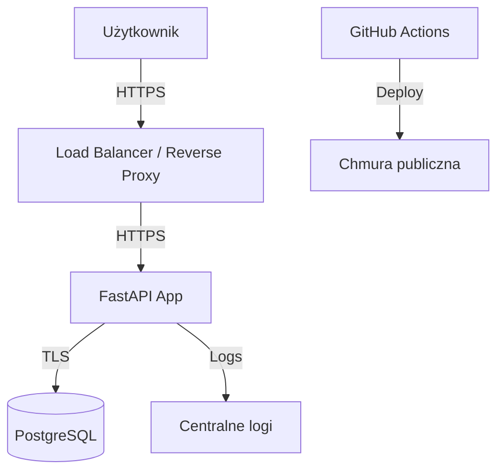

# MycoForum – Cyberbezpieczne Forum dla Pasjonatów Grzybów

Bezpieczne forum internetowe dla miłośników grzybów, zbudowane z naciskiem na bezpieczeństwo aplikacji webowych zgodnie z OWASP ASVS 5.0, CIS Benchmarks oraz wymaganiami przedmiotu *Bezpieczeństwo serwerów i aplikacji Web*.

## Opis

Aplikacja umożliwia:
- Rejestrację i logowanie użytkowników
- Tworzenie, edycję i usuwanie postów oraz komentarzy (tylko własnych)
- Bezpieczne przechowywanie haseł (Argon2id)
- Sesje z bezpiecznymi ciasteczkami
- Ochronę przed CSRF, XSS, SQLi
- Nagłówki bezpieczeństwa
- Rate limiting przy logowaniu

## Architektura



- **Frontend**: Jinja2 templates (SSR) – łatwiejsza kontrola XSS
- **Backend**: FastAPI + Starlette
- **Baza**: PostgreSQL (osobno, niedostępna z internetu)
- **Auth**: Sesje serwerowe + Argon2id
- **Deploy**: Docker + GitHub Actions

## Decyzje bezpieczeństwa

| Wymaganie | Implementacja |
|-----------|---------------|
| W-02 Hasła Argon2id | `passlib` z Argon2id (m=65536, t=3, p=4 lub zgodnie z OWASP) |
| W-04 Ciasteczka sesji | Secure, HttpOnly, SameSite=Lax |
| W-05 Nowa sesja / unieważnienie | SessionMiddleware + czyszczenie przy logout |
| W-06 CSRF | `starlette-csrf` + token w formularzach |
| W-08 XSS | Auto-escaping Jinja2 + CSP |
| W-09 SQLi | SQLAlchemy ORM / parametryzowane |
| W-11 HTTPS | Reverse proxy / LB z certyfikatem |
| W-12 Sekrety | Zmienne środowiskowe / secret manager, nigdy w repo |
| W-16 Nagłówki | Middleware z HSTS, X-Content-Type-Options, CSP, Referrer-Policy |
| W-29 Rate limiting | slowapi na /login |
| W-30 Logi bezpieczeństwa | Structured logging logowań i odmów |

## Jak uruchomić lokalnie

```bash
cd mycoforum
python -m venv venv
source venv/bin/activate
pip install -r requirements.txt
# Ustaw DATABASE_URL i SECRET_KEY w .env
uvicorn app.main:app --reload
```

## Użycie AI

Projekt został wygenerowany i ziterowany z pomocą Grok (xAI). Cały kod został zweryfikowany przez zespół pod kątem bezpieczeństwa i wymagań przedmiotu. Odpowiadamy za każdą linię.

## Podział pracy (do uzupełnienia przez zespół)

- Osoba 1: Auth, sesje, hasła
- Osoba 2: Modele, posty, komentarze, autoryzacja
- Osoba 3: Infra, CI/CD, hardening, dokumentacja

## Repo publiczne

Branch protection, CodeQL, secret scanning włączone na GitHubie.
